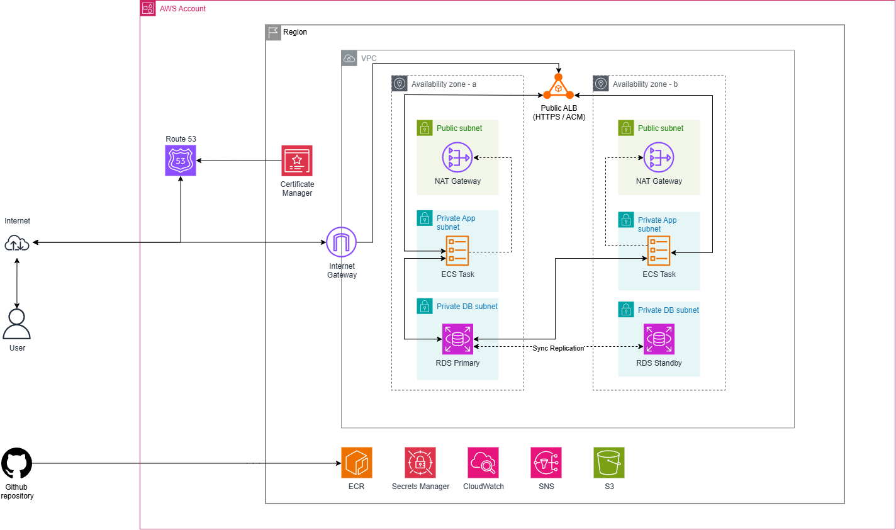

# Deployment & Architecture Guide

Technical reference for the AWS infrastructure architecture, Terraform modules, and CI/CD pipelines.

---

## 1. Network Architecture

<p align="center">
  
</p>

The infrastructure implements an end-to-end 3-tier VPC across 2 Availability Zones (`ap-southeast-2a`, `ap-southeast-2b`) with external DNS, TLS termination, and regional supporting services:

```
                             [ User / Clients ]
                                      │
               ┌──────────────────────┴──────────────────────┐
               │                                             │
               ▼ (1. DNS Resolution)                         ▼ (2. HTTP/HTTPS Traffic)
  ┌─────────────────────────┐                   ┌─────────────────────────┐
  │   AWS Route 53 (DNS)    │                   │   INTERNET (Public Web) │
  │ (Managed outside TF)    │                   └────────────┬────────────┘
  └─────────────────────────┘                                │
                                                             ▼
                                                ┌─────────────────────────┐
                                                │ Internet Gateway (IGW)  │
                                                └────────────┬────────────┘
                                                             │
  ┌── AWS Region (ap-southeast-2) ───────────────────────────┼────────────────────────────────┐
  │                                                          │                                │
  │   [ AWS Certificate Manager (ACM) ] ──(SSL/TLS)──►       ▼                                │
  │                                                ┌───────────────────┐                      │
  │                                                │    Public ALB     │ (Port 80 / 443)      │
  │                                                └─────────┬─────────┘                      │
  │                                                          │                                │
  │  ┌── VPC ────────────────────────────────────────────────┼────────────────────────────┐   │
  │  │                                                       │                            │   │
  │  │                     ┌─────────────────────────────────┴─────────────────┐          │   │
  │  │                     ▼                                                   ▼          │   │
  │  │        ┌─────────────────────────┐                         ┌─────────────────────┐ │   │
  │  │        │   Availability Zone A   │                         │ Availability Zone B │ │   │
  │  │        │                         │                         │                     │ │   │
  │  │        │ ┌─────────────────────┐ │                         │ ┌─────────────────┐ │ │   │
  │  │        │ │ Public Subnet       │ │                         │ │ Public Subnet   │ │ │   │
  │  │        │ │   [ NAT Gateway A ] │◄──(Egress)──┐ ┌──(Egress)─┼─► [ NAT Gateway B]│ │ │   │
  │  │        │ └─────────────────────┘ │           │ │           │ └─────────────────┘ │ │   │
  │  │        │                         │           │ │           │                     │ │   │
  │  │        │ ┌─────────────────────┐ │           │ │           │ ┌─────────────────┐ │ │   │
  │  │        │ │ Private App Subnet  │ │           │ │           │ │ Private App Sub │ │ │   │
  │  │        │ │   [ ECS Task A ]    │─┴───────────┘ └───────────┴─│   [ ECS Task B] │ │ │   │
  │  │        │ └──────────┬──────────┘                             └──────────┬──────┘ │ │   │
  │  │        │            │ (Port 5432)                                       │        │ │   │
  │  │        │            └───────────────────┐       ┌───────────────────────┘        │ │   │
  │  │        │                                ▼       ▼                                │ │   │
  │  │        │ ┌─────────────────────┐     ┌─────────────────────┐                     │ │   │
  │  │        │ │ Private DB Subnet   │     │ Private DB Subnet   │                     │ │   │
  │  │        │ │  [ RDS Primary ]    │◄───►│  [ RDS Standby ]    │                     │ │   │
  │  │        │ │  (PostgreSQL 16.1)  │Sync │  (Prod Multi-AZ)    │                     │ │   │
  │  │        │ └─────────────────────┘Repl └─────────────────────┘                     │ │   │
  │  │        └─────────────────────────────────────────────────────────────────────────┘ │   │
  │  └────────────────────────────────────────────────────────────────────────────────────┘   │
  │                                                                                           │
  │  ┌── Supporting Regional Services ────────────────────────────────────────────────────┐   │
  │  │  • Amazon ECR: Stores immutable container images pushed by GitHub Actions CI/CD    │   │
  │  │  • AWS Secrets Manager: Injects DB credentials & environment variables into ECS    │   │
  │  │  • Amazon CloudWatch & SNS: Collects metrics/logs and triggers email alert alarms  │   │
  │  └────────────────────────────────────────────────────────────────────────────────────┘   │
  └───────────────────────────────────────────────────────────────────────────────────────────┘
```

> **Note on DNS, Ingress & Scope:**
> - **Route 53 & ACM:** Route 53 routes public traffic to the ALB via an Alias/CNAME record, and ACM provides the SSL/TLS certificate for HTTPS termination. Route 53 hosted zones and top-level domain registrations are managed outside this Terraform configuration to avoid accidental deletion.
> - **Ingress Flow:** Public traffic flows from the Internet Gateway directly to the Public ALB, which distributes traffic across private ECS Fargate tasks on port 8000.
> - **Egress Flow:** Containers in private application subnets reach the internet (e.g., for ECR image pulls and outbound API requests) via NAT Gateways in the public subnets.


### Subnet Allocation

Each environment uses a `/16` VPC partitioned into `/20` subnets:

| Subnet Type | Dev (`10.10.0.0/16`) | Staging (`10.20.0.0/16`) | Prod (`10.30.0.0/16`) | Target Routing |
| :--- | :--- | :--- | :--- | :--- |
| **Public AZ-a** | `10.10.0.0/20` | `10.20.0.0/20` | `10.30.0.0/20` | Internet Gateway (IGW) |
| **Public AZ-b** | `10.10.16.0/20` | `10.20.16.0/20` | `10.30.16.0/20` | Internet Gateway (IGW) |
| **App AZ-a** | `10.10.32.0/20` | `10.20.32.0/20` | `10.30.32.0/20` | NAT Gateway 1 |
| **App AZ-b** | `10.10.48.0/20` | `10.20.48.0/20` | `10.30.48.0/20` | NAT Gateway 1 (or 2 in Prod) |
| **DB AZ-a** | `10.10.64.0/20` | `10.20.64.0/20` | `10.30.64.0/20` | Isolated (Local VPC only) |
| **DB AZ-b** | `10.10.80.0/20` | `10.20.80.0/20` | `10.30.80.0/20` | Isolated (Local VPC only) |

---

## 2. Environment Matrix

| Parameter | Dev | Staging | Prod |
| :--- | :--- | :--- | :--- |
| **VPC CIDR** | `10.10.0.0/16` | `10.20.0.0/16` | `10.30.0.0/16` |
| **High Availability** | Single-AZ | Single-AZ | Multi-AZ |
| **NAT Gateways** | 1 | 1 | 2 (1 per AZ) |
| **RDS Instance Class** | `db.t4g.micro` | `db.t4g.micro` | `db.t4g.micro` |
| **RDS Multi-AZ** | `false` | `false` | `true` |
| **ECS Task CPU / RAM** | 256 / 512 | 256 / 512 | 256 / 512 |
| **ECS Desired Count** | 1 | 1 | 2 |
| **Promotion Trigger** | Push to `main` | Auto after Dev test | Manual Approval |

### Sizing & Tier Selection Rationale

#### 1. Compute Tier (ECS Fargate: 256 CPU / 512 MiB RAM)
- **Engine (AWS Fargate)**: Serverless compute eliminates EC2 host provisioning, OS patching, and capacity management overhead. You pay only for the exact container resources consumed.
- **Task Sizing (`256` CPU / `512` MiB)**: The demo application ([`compose-demo`](../app/compose-demo)) is a lightweight single-file FastAPI service (~870 bytes) running on `python:3.11-slim` with a single Uvicorn worker. Typical idle memory footprint is ~60–100 MiB. Allocating 0.25 vCPU / 512 MiB gives a safe ~5x memory buffer to handle traffic bursts without paying for unused capacity.
- **Instance Count (1 in Dev/Staging vs. 2 in Prod)**:
  - **Dev & Staging (Desired Count = 1)**: Single task minimizes non-production cost while verifying deployment pipelines and endpoint functionality.
  - **Prod (Desired Count = 2)**: Tasks are distributed across Availability Zones (`ap-southeast-2a`, `ap-southeast-2b`) behind the ALB for High Availability, ensuring zero-downtime rolling updates and failover resiliency. Target tracking autoscaling dynamically adds tasks if sustained CPU exceeds 70%.

#### 2. Database Tier (RDS PostgreSQL 16.1: `db.t4g.micro`)
- **Instance Sizing (`db.t4g.micro`)**: Offers 2 burstable vCPUs and 1 GiB RAM with baseline EBS bandwidth. Because the application only performs simple health-checks and low-concurrency database queries (`SELECT 1;`), `db.t4g.micro` easily satisfies workload demands without unnecessary baseline overhead.
- **Storage Allocation (20 GB `gp3` with Autoscaling)**: Starts at the minimum 20 GB allocation to keep baseline storage costs at ~$2.30/month, with `max_allocated_storage` autoscaling enabled up to 100 GB if database size grows.
- **High Availability (Single-AZ vs. Multi-AZ)**:
  - **Dev & Staging (`db_multi_az = false`)**: Single-AZ deployment cuts non-production database costs by 50%.
  - **Prod (`db_multi_az = true`)**: Provisions a synchronous standby replica in the second AZ. Provides automated failover (typically 60–120s RTO) and zero data loss (RPO = 0) during underlying host degradation or AZ outages.

##### Decision Matrix: Why `db.t4g.micro` over `db.t3.micro`?

| Comparison Metric | `db.t4g.micro` (Chosen) | `db.t3.micro` (Rejected) | Impact / Rationale |
| :--- | :--- | :--- | :--- |
| **CPU Architecture** | **64-bit ARM (AWS Graviton2)** | Legacy x86_64 (Intel Xeon Platinum) | Graviton2 has dedicated L1/L2 cache per core, delivering more consistent query throughput. |
| **Hourly Rate (`ap-southeast-2`)** | **~$0.021 / hr** | ~$0.023 / hr | `db.t4g.micro` is **~8–10% cheaper** out of the box for identical 2 vCPU / 1 GiB capacity. |
| **PostgreSQL Efficiency** | **Up to 20–35% better price-performance** | Baseline legacy performance | PostgreSQL 16.1 is optimized for ARM64 instruction pipelining and memory bandwidth. |
| **System Virtualization** | **Full AWS Nitro System** | Older hypervisor / early Nitro | Lower latency jitter and faster network/EBS packet processing. |
| **Application Impact** | **Zero changes needed** | Baseline | RDS is fully managed; AWS manages the database binary, making the ARM architecture completely transparent to the FastAPI client. |

> **Conclusion:** `db.t3.micro` was rejected because it costs more, performs worse on PostgreSQL workloads, runs on older x86 hardware, and offers zero technical advantage over the Graviton2-powered `db.t4g.micro`.


---

## 3. Security Groups & Traffic Rules

Traffic flows strictly from outer to inner tiers:

1. **ALB Security Group (`alb-sg`)**:
   - Ingress: Port 80 from `0.0.0.0/0`.
   - Egress: Port 8000 to `app-sg`.

2. **ECS Security Group (`app-sg`)**:
   - Ingress: Port 8000 only from `alb-sg`.
   - Egress: Port 5432 to `db-sg`, HTTPS (443) to internet/VPC endpoints for ECR and Secrets Manager.

3. **RDS Security Group (`db-sg`)**:
   - Ingress: Port 5432 only from `app-sg`.
   - Egress: None (fully private database tier).

---

## 4. Components & Terraform Modules

- **`network`**: Manages VPC, subnets, route tables, internet gateway, and NAT gateways.
- **`security_groups`**: Creates least-privilege security groups for ALB, ECS, and RDS.
- **`alb`**: Public load balancer, target group (`/health` probe), and HTTP listener.
- **`ecs`**: Fargate cluster, task definition, IAM execution/task roles, CloudWatch log group, and service configuration. Uses `lifecycle { ignore_changes = [desired_count] }` to allow autoscaling.
- **`ecr`**: Container repository with lifecycle policy (retains last 30 tagged images).
- **`rds`**: PostgreSQL 16.1 engine, subnet group across 2 AZs, and automated credentials generated in Secrets Manager.
- **`monitoring`**: CloudWatch metric alarms for ALB 5xx errors and high ECS memory, hooked to an SNS alert topic.

> **External / Pre-existing Services (Non-Terraform):**
> - **`Route 53`**: Public DNS hosted zone and domain routing to ALB DNS name (managed externally or at organization root to decouple lifecycle from environment tear-downs).
> - **`ACM`**: SSL/TLS certificate provisioned with DNS validation for HTTPS listeners.

---

## 5. Secrets Management Architecture

To avoid storing credentials or application configs in GitHub Actions:
- **`tru-demo-<env>-db-credentials`**: Contains database host, port, username, password, and connection string.
- **`tru-demo-<env>-app-secrets`**: Contains application environment variables (`APP_ENV`, `LOG_LEVEL`, API keys).
- **Injection Mechanism**: The ECS Task Execution Role has IAM permissions (`secretsmanager:GetSecretValue`) to inject these values as environment variables directly at container launch.
- **Configuration Updates**: Changes made in AWS Secrets Manager are picked up on the next rolling update (`aws ecs update-service --force-new-deployment`).

---

## 6. CI/CD Workflows

The repository uses GitHub Actions for continuous integration and delivery:

1. **PR Quality Check ([`ci.yml`](../.github/workflows/ci.yml))**:
   - Runs `terraform fmt -check` and `terraform validate`.
   - Runs `checkov` security scanning on Terraform code.
   - Generates speculative plan diff and posts summary to PR comments.

2. **Infrastructure Provisioning ([`iac-provision-pipeline.yml`](../.github/workflows/iac-provision-pipeline.yml))**:
   - Automatically plans and applies changes to `dev` upon merge to `main`.
   - Runs curl health check against ALB.
   - Automatically applies to `staging`.
   - Pauses for manual approval before applying to `prod`.
   - Supports targeted execution via the `target` input parameter (e.g., `module.ecs`).

3. **Application Delivery ([`application-deployment-pipeline.yml`](../.github/workflows/application-deployment-pipeline.yml))**:
   - Lints application code with `flake8`.
   - Builds container image and pushes to ECR.
   - Deploys progressively to Dev &rarr; Staging &rarr; Prod.
   - Enforces tag policies: Dev/Staging use commit SHA; Prod strictly requires a release version tag (e.g., `v1.0.0`).

4. **Infrastructure Teardown ([`iac-destroy-pipeline.yml`](../.github/workflows/iac-destroy-pipeline.yml))**:
   - Requires manual entry of `confirm_destroy: "DESTROY"`.
   - Can destroy individual modules or entire environments.

---

## 7. Cost Estimation

Estimated monthly cost in `ap-southeast-2` (Sydney), On-Demand pricing. Assumptions:

- **Prod** runs 24/7 (730 hours/month).
- **Dev and Staging** run only **8:00-19:00, Monday-Friday** (11 h x 5 days x ~4.33 weeks = **~238 hours/month**, about 33% of a full month). Hourly-billed resources (NAT Gateway, ALB, Fargate, RDS instance) are prorated; RDS storage, Secrets Manager, ECR, and logs are kept at full monthly cost as a conservative estimate.
- Low traffic (~1 LCU, < 50 GB outbound/NAT data), 20 GB RDS storage, 2 Secrets Manager secrets, small log volume.

Figures are approximate; validate with the [AWS Pricing Calculator](https://calculator.aws/) before committing.

| Component | Dev (238 h) | Staging (238 h) | Prod (730 h) | Basis |
| :--- | :---: | :---: | :---: | :--- |
| **NAT Gateway** (+ public IPv4) | $15 | $15 | $93 | ~$0.064/h per gateway incl. IPv4; Prod has 2 |
| **Application Load Balancer** | $10 | $10 | $32 | ~$0.043/h incl. LCU and 2 public IPv4 |
| **ECS Fargate** | $4 | $4 | $22 | 0.25 vCPU/0.5 GB; Prod runs 2 tasks |
| **RDS PostgreSQL** (instance + storage) | $8 | $8 | $35 | `db.t4g.micro`; Prod is Multi-AZ (instance and storage x2) |
| **Secrets Manager** | $1 | $1 | $1 | $0.40 per secret |
| **CloudWatch** (logs, alarms, insights) | $1 | $1 | $5 | Log ingestion, alarms, optional Container Insights |
| **ECR** (storage) | $1 | $1 | $1 | ~$0.10/GB-month |
| **S3 & DynamoDB** (Terraform State) | < $0.05 | < $0.05 | < $0.05 | State storage (< 5 MB) + lock table (Free Tier) |
| **Monthly Total** | **~$40** | **~$40** | **~$189** | |

**Estimated total for all three environments: ~$269/month** (vs ~$465/month with larger Prod sizing and Dev/Staging running 24/7, a saving of about 42%).

> **Right-sizing:** The demo app ([`app/compose-demo`](../app/compose-demo)) is a single-file FastAPI service (~870 bytes of code) with a `/health` probe and a one-query DB check, running one `uvicorn` process on `python:3.11-slim` (image ~150-200 MB). Expected memory is ~60-100 MB, well inside the smallest Fargate size of 0.25 vCPU / 0.5 GB, so all environments use that tier. Prod keeps 2 tasks for high availability rather than larger tasks. Re-check CPU/memory in CloudWatch after load testing, and scale up only if sustained usage exceeds ~70%.

> **Not included:** Route 53 hosted zone (~$0.50/month) and domain registration (managed outside Terraform), data transfer out beyond the free tier, and RDS backup storage beyond the free allocation.

> **How the schedule is achieved:** The saving only applies if NAT Gateways and ALBs are actually removed outside working hours, because they cannot be paused. Use [`iac-destroy-pipeline.yml`](../.github/workflows/iac-destroy-pipeline.yml) and [`iac-provision-pipeline.yml`](../.github/workflows/iac-provision-pipeline.yml) on a schedule (e.g. provision at 07:45, destroy at 19:00, Mon-Fri). If you only scale ECS to 0 and stop RDS, NAT and ALB keep billing and Dev/Staging stay at ~$75 each.

### Cost Drivers

1. **Prod is ~70% of the total bill**, mainly the 2 NAT Gateways (~$93), the ALB (~$32), and Multi-AZ RDS (~$35).
2. **NAT Gateways are the largest line item** in every environment. They bill hourly regardless of traffic.
3. **RDS Multi-AZ doubles the database cost** in Prod, in exchange for automatic failover.
4. **The ALB has a fixed hourly floor** that does not scale to zero.

### Optimization Options

| Option | Saving | Trade-off |
| :--- | :--- | :--- |
| Fargate Spot for Dev/Staging | Up to 70% of a small ECS cost | Tasks can be interrupted |
| Single NAT Gateway in Prod (instead of 1 per AZ) | ~$47/month | Loses AZ-level egress resilience |
| Fargate / RDS Savings Plans or Reserved Instances for Prod | ~20-40% | 1-3 year commitment |
| Add VPC endpoints for ECR, S3, Secrets Manager, and CloudWatch Logs | Lowers NAT data charges | Interface endpoints cost ~$10/month each, so only worthwhile at higher traffic |
| Lower `log_retention_days` in non-prod | Small | Shorter debugging history |

### Budget Guardrail

Each environment exposes a `monthly_budget_usd` variable. Suggested values: Dev `50`, Staging `50`, Prod `230` (about 20-25% headroom above the estimates).

