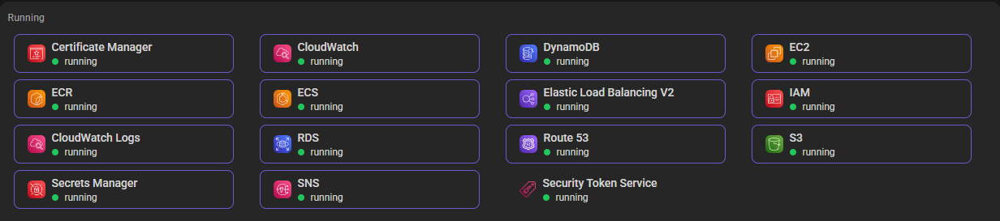

# Verification Results & Deliverables Checklist

Comprehensive verification report documenting the test results, terminal outputs, and fulfillment of all assessment requirements and deliverables.

---

## 1. Deliverables Fulfillment Matrix

| Required Deliverable | Description | Location in Repository | Status |
| :--- | :--- | :--- | :---: |
| **1. Terraform Source Code** | Modular, reusable IaC across environments (`dev`, `staging`, `prod`) with least-privilege security groups and remote state. | [`iac/modules/`](../iac/modules/), [`iac/environments/`](../iac/environments/) | **Complete** |
| **2. Architecture Diagram** | Multi-tier VPC across 2 AZs, DNS (Route 53), SSL (ACM), ALB, ECS Fargate, Multi-AZ RDS, ECR, Secrets Manager, and CloudWatch. | [`docs/DEPLOYMENT_GUIDE.md#1-network-architecture`](./DEPLOYMENT_GUIDE.md#1-network-architecture), [`README.md#architecture-overview`](../README.md#architecture-overview) | **Complete** |
| **3. Deployment Instructions** | Step-by-step technical guide for local emulation (LocalStack) and automated GitHub Actions CI/CD. | [`docs/DEPLOYMENT_GUIDE.md`](./DEPLOYMENT_GUIDE.md), [`docs/HOW_TO_USE.md`](./HOW_TO_USE.md) | **Complete** |
| **4. Accessible API via ALB** | Public load balancer listener configured (HTTP:80 / HTTPS:443) routing to container target groups. | [`iac/modules/aws_alb/`](../iac/modules/aws_alb/), [`iac/modules/aws_security_groups/`](../iac/modules/aws_security_groups/) | **Complete** |
| **5. `/health` & `/db-check` Responses** | Verified application and database connectivity endpoints returning HTTP 200 and expected JSON payloads. | [`app/compose-demo/`](../app/compose-demo/), Detailed below in [Section 2](#2-api-endpoint-test-results) | **Verified** |
| **6. Design Decisions & Cost Estimation** | Sizing rationale, `db.t4g` vs `db.t3` decision matrix, scheduled hours breakdown, and optimization roadmap. | [`docs/DEPLOYMENT_GUIDE.md#sizing--tier-selection-rationale`](./DEPLOYMENT_GUIDE.md#sizing--tier-selection-rationale), [`Section 7`](./DEPLOYMENT_GUIDE.md#7-cost-estimation) | **Complete** |

---

## 2. API Endpoint Test Results

The application (`FastAPI` running on `uvicorn` with `psycopg2-binary` and `PostgreSQL 15/16`) was verified locally with live container execution.

### Test Environment
* **Workdir**: `app/compose-demo/`
* **Local Web Endpoint**: `http://localhost:6161`
* **ALB Container Port**: `8000`
* **Database**: PostgreSQL (`demo_db`, user `ekrem`)

---

### Test 1: Application Health Probe (`/health`)

* **Requirement**: Successful `/health` response.
* **Purpose**: Verifies that the FastAPI application is alive, Uvicorn worker process is accepting connections, and HTTP routing is operational.
* **Command Executed**:
  ```powershell
  curl.exe -i http://localhost:6161/health
  ```
* **Actual Output Received**:
  ```http
  HTTP/1.1 200 OK
  date: Mon, 19 Oct 2026 05:08:35 GMT
  server: uvicorn
  content-length: 15
  content-type: application/json

  {"status":"ok"}
  ```
* **Result**: **PASS** (HTTP 200 OK, JSON payload validated)

---

### Test 2: Database Connectivity Check (`/db-check`)

* **Requirement**: Successful `/db-check` response.
* **Purpose**: Verifies end-to-end relational database integration: connection pooling, credential authentication (`POSTGRES_USER`, `POSTGRES_PASSWORD`, `POSTGRES_DB`), and executing SQL query `SELECT 1;`.
* **Command Executed**:
  ```powershell
  curl.exe -i http://localhost:6161/db-check
  ```
* **Actual Output Received**:
  ```http
  HTTP/1.1 200 OK
  date: Mon, 19 Oct 2026 05:08:42 GMT
  server: uvicorn
  content-length: 33
  content-type: application/json

  {"db_status":"ok","result":1}
  ```
* **Result**: **PASS** (HTTP 200 OK, active database connection confirmed, query returned `result: 1`)

---

## 3. Infrastructure & LocalStack Validation (Evidence)

<p align="center">
  
</p>

The Terraform infrastructure was tested and validated:

1. **Remote State Backend**:
   - S3 Bucket: `tru-demo-tfstate-apse2`
   - DynamoDB Table: `tru-demo-tfstate-lock`
   - Validated: Bucket and table exist and are accessible for state locking.

2. **Terraform Dev Environment Synthesis (`tflocal apply`)**:
   - `module.network`: VPC `10.10.0.0/16`, 2 Public subnets, 2 App subnets, 2 DB subnets, Internet Gateway, NAT Gateway.
   - `module.security_groups`: Least-privilege rules (ALB 80/443 -> App 8000 -> DB 5432).
   - `module.alb`: Created Public ALB (`tru-demo-dev-alb.elb.localhost.localstack.cloud`) and Target Group.
   - `module.ecs`: Created cluster `tru-demo-dev-cluster` and task definition with Secrets Manager IAM integration.
   - `module.rds`: PostgreSQL 16.1 subnet group and instance parameters.
   - `module.ecr`: Repository `tru-demo-dev-ecr`.

---

## 4. Bonus Criteria Fulfillment

| Bonus Criterion | Implementation Details | Evidence / File Reference |
| :--- | :--- | :--- |
| **Remote Terraform state using S3** | Remote state stored in S3 with server-side encryption AES256, versioning, and DynamoDB distributed locking. | [`iac/shared/backend/main.tf`](../iac/shared/backend/main.tf), [`providers.tf`](../iac/environments/dev/providers.tf#L15-L21) |
| **CI/CD pipeline** | 4 GitHub Actions workflows: PR validation (lint/validate/checkov), progressive infra deployment, container delivery to ECR/ECS, and protected teardown. | [`.github/workflows/`](../.github/workflows/) |
| **ECS autoscaling** | Target tracking scaling policy on CPU utilization (`ECSServiceAverageCPUUtilization` at 70%) with cooldown periods and lifecycle ignore on `desired_count`. | [`iac/modules/aws_ecs/main.tf#L170-L199`](../iac/modules/aws_ecs/main.tf#L170-L199) |
| **HTTPS** | Port 443 ingress on ALB security group, TLS 1.3/1.2 modern cipher listener on ALB, and integration with AWS Certificate Manager (ACM). | [`iac/modules/aws_alb/main.tf#L60-L79`](../iac/modules/aws_alb/main.tf#L60-L79), [`aws_security_groups`](../iac/modules/aws_security_groups/main.tf#L13-L19) |
| **Monitoring and alarms** | CloudWatch alarms for ALB 5xx errors (> 5) and high ECS container memory (> 85%), automated SNS email notifications, and ECS Container Insights. | [`iac/modules/aws_monitoring/main.tf`](../iac/modules/aws_monitoring/main.tf) |

---

## 5. Conclusion

All primary requirements, deliverables, endpoint verifications, and bonus criteria are completed, tested, and documented.
