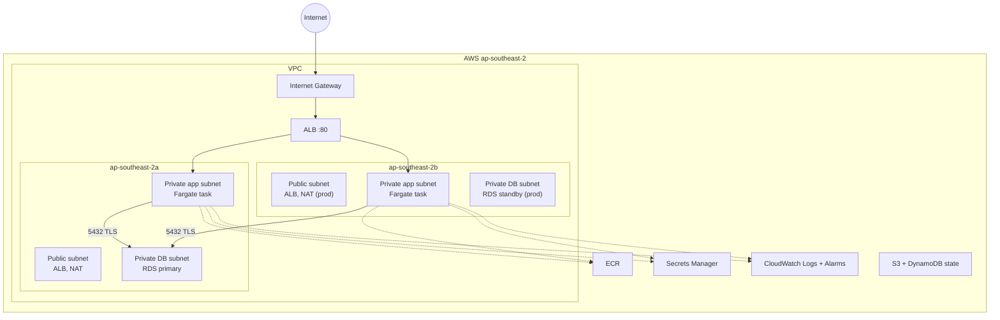

# Enterprise Implementation Plan v2: FastAPI + PostgreSQL on AWS (Terraform)

**Source repo:** `ucuncuekremkemal/postgres-fastapi-deployment`
**Region:** `ap-southeast-2` (Sydney), AZs `ap-southeast-2a` and `ap-southeast-2b`
**Environments:** `dev`, `staging`, `prod` (dev and staging on a lower tier than prod)
**CI/CD:** GitHub Actions (OIDC to AWS)
**Scope note:** Demo exercise, so no custom domain. Public access is HTTP via the ALB DNS name. HTTPS is an optional module, off by default.

> [!NOTE]
> Changes from v1: your answers are applied, the folder layout now follows your convention, and a naming and standards section is added.

---

## 1. Repo findings

| Item | Finding | Action |
|---|---|---|
| Two apps | `compose-demo/` and `k8s-event-api/` | Deploy **`compose-demo`** (simplest match for `/health` and `/db-check`). Phase 0 confirms the endpoints and adds them if missing |
| Config | Reads `DB_HOST`, `DB_PORT`, `DB_NAME`, `DB_USER`, `DB_PASSWORD` | Maps directly onto ECS `environment` and `secrets` |
| Hardcoded password defaults | Present in `main.py` | Remove, fail fast when unset |
| Dockerfile | Root user, unpinned deps, no healthcheck | Non-root, pin versions, add `HEALTHCHECK` |
| DB TLS | No `sslmode` | Add `sslmode=require` |

---

## 2. Architecture



**Security groups (reference-based chaining):**

| SG | Inbound | Outbound |
|---|---|---|
| `alb` | 80 from `0.0.0.0/0` | 8000 to `app` |
| `app` | 8000 from `alb` | 5432 to `db`, 443 out (ECR, Secrets, Logs) |
| `db` | 5432 from `app` | none |

---

## 3. Terraform folder structure (Enterprise iac layout)

```
Trustify/
├── app/                        # FastAPI app + hardened Dockerfile
├── docs/                       # architecture, cost, decisions, runbook
├── .github/workflows/          # ci.yml, deploy.yml
├── iac/
│   ├── shared/
│   │   └── backend/            # S3 remote state bucket + DynamoDB lock table
│   │       ├── main.tf
│   │       ├── outputs.tf
│   │       ├── providers.tf
│   │       ├── terraform.tfvars
│   │       └── variables.tf
│   ├── modules/
│   │   ├── aws_network/        # VPC, subnets, IGW, NAT, route tables
│   │   │   ├── main.tf
│   │   │   ├── outputs.tf
│   │   │   └── variables.tf
│   │   ├── aws_security_groups/
│   │   ├── aws_ecr/
│   │   ├── aws_rds/            # RDS, subnet group, param group, managed secret
│   │   ├── aws_alb/
│   │   ├── aws_ecs/            # cluster, task def, service, IAM, logs, autoscaling
│   │   └── aws_monitoring/     # SNS, alarms, dashboard
│   └── environments/
│       ├── dev/
│       │   ├── main.tf         # module calls and wiring
│       │   ├── outputs.tf
│       │   ├── providers.tf    # provider and backend configuration
│       │   ├── terraform.tfvars
│       │   └── variables.tf
│       ├── staging/
│       │   ├── main.tf
│       │   ├── outputs.tf
│       │   ├── providers.tf
│       │   ├── terraform.tfvars
│       │   └── variables.tf
│       └── prod/
│           ├── main.tf
│           ├── outputs.tf
│           ├── providers.tf
│           ├── terraform.tfvars
│           └── variables.tf
└── .gitignore
```

Rules: environment folders hold **only** module calls and wiring. All resources live in `modules/`. Each env has its own state key (`dev/terraform.tfstate`, etc.). Modules never define providers or backends.

---

## 4. Naming conventions

**AWS resource names:** `<project>-<env>-<resource>[-<qualifier>]`, all lowercase, hyphen-separated.
Project code: `trustify`. Example for dev:

| Resource | Name |
|---|---|
| VPC | `trustify-dev-vpc` |
| Subnets | `pgfastapi-dev-public-2a`, `pgfastapi-dev-app-2a`, `pgfastapi-dev-db-2a` |
| NAT / IGW | `pgfastapi-dev-nat-2a`, `pgfastapi-dev-igw` |
| Security groups | `pgfastapi-dev-alb-sg`, `-app-sg`, `-db-sg` |
| ALB / Target group | `pgfastapi-dev-alb`, `pgfastapi-dev-tg` |
| ECS cluster / service | `pgfastapi-dev-cluster`, `pgfastapi-dev-api-svc` |
| Task roles | `pgfastapi-dev-ecs-exec-role`, `pgfastapi-dev-ecs-task-role` |
| RDS | `pgfastapi-dev-pg` |
| Log group | `/ecs/pgfastapi-dev/api` |
| ECR | `pgfastapi/api` (shared, tags carry env) |
| State bucket | `pgfastapi-tfstate-<account_id>-apse2` |
| Lock table | `pgfastapi-tfstate-lock` |

**Terraform code:**
- Identifiers `snake_case`. A module's single main resource is named `this`
- Variables: descriptive, no abbreviations, always with `type` and `description`. Booleans start with `enable_` or `is_`
- Outputs: `<resource>_<attribute>` (e.g. `alb_dns_name`, `rds_secret_arn`)
- Files: `main.tf`, `variables.tf`, `outputs.tf` per module (plus `versions.tf` in env folders if needed)
- Locals: `local.name_prefix = "${var.project}-${var.environment}"`

**Mandatory tags** (via provider `default_tags`): `Project`, `Environment`, `ManagedBy=terraform`, `Owner`, `CostCenter`, `Repository`.

---

## 5. Environment tiers (`terraform.tfvars` per environment)

| Setting | dev | staging | prod |
|---|---|---|---|
| VPC CIDR | `10.10.0.0/16` | `10.20.0.0/16` | `10.30.0.0/16` |
| AZs | 2 | 2 | 2 |
| NAT gateways | 1 | 1 | 2 (one per AZ) |
| Fargate CPU / memory | 256 / 512 | 256 / 512 | 512 / 1024 |
| Task count (min / max) | 1 / 2 | 2 / 3 | 2 / 6 |
| Autoscaling | off | on (CPU 70%) | on (CPU 60% + req/target) |
| RDS class | `db.t4g.micro` | `db.t4g.micro` | `db.t4g.small` |
| RDS storage | 20 GB | 20 GB | 50 GB (autoscale to 100) |
| RDS Multi-AZ | no | no | **yes** |
| Backup retention | 1 day | 3 days | 14 days |
| Deletion protection | off | off | **on** |
| Final snapshot on destroy | skip | skip | **required** |
| Log retention | 7 days | 14 days | 90 days |
| Alarms to SNS | basic | basic | full set |
| Container Insights | off | off | on |

`terraform.tfvars` holds only non-secret values. Credentials are never in tfvars.

---

## 6. Design decisions

| # | Decision | Rationale |
|---|---|---|
| D1 | RDS `manage_master_user_password = true` | Secret created and rotated by AWS. **Password never touches Terraform code or state** |
| D2 | ECS `secrets` use `valueFrom = <secret_arn>:password::` and `:username::` | Injected at start by the execution role. Host, port and DB name are plain env vars |
| D3 | Separate execution role and task role | Execution role is limited to ECR pull, one log group and one secret ARN. Task role is empty |
| D4 | 3 subnet tiers across 2 AZs | DB subnets have no internet route |
| D5 | Security groups chained by SG id | No CIDR-based internal rules |
| D6 | Graviton (ARM64) Fargate | About 20% cheaper. CI builds `linux/arm64` |
| D7 | Deployment circuit breaker with rollback | Bad releases auto-revert |
| D8 | Immutable image tags (git SHA) | Traceable, no `latest` |
| D9 | Remote state in S3 (versioned, SSE, public-blocked) with DynamoDB locking, one key per environment | Safe team use |
| D10 | Separate state per environment (not workspaces) | Matches your folder convention, isolates blast radius |
| D11 | Staging mirrors prod topology, with smaller sizes | Realistic pre-prod validation |
| D12 | HTTPS optional (`enable_https = false`) | No domain in this exercise. Module supports ACM and 443 when a domain is supplied |

---

## 7. Enterprise best practices applied

**Security**
- No secrets in repo, tfvars, state, task definition or CI logs
- Encryption at rest (RDS, S3, logs) and in transit (TLS to DB, `rds.force_ssl=1`)
- IAM scoped to specific ARNs, no wildcard resources unless AWS requires it
- RDS `publicly_accessible = false`, ECS tasks have no public IP
- ECR scan on push, immutable tags, lifecycle policy
- Block public access on S3 state bucket

**Code quality**
- Pinned Terraform (`required_version`) and provider (`~> 5.x`) versions, committed `.terraform.lock.hcl`
- Variable `validation` blocks (CIDR format, allowed env values, size limits)
- `terraform fmt`, `validate`, `tflint`, `checkov` in CI
- `pre-commit` hooks for the same checks
- Module READMEs generated with `terraform-docs`

**Operations**
- Health checks (ALB `/health`, container `HEALTHCHECK`)
- Alarms to SNS (ALB 5xx, unhealthy hosts, latency, ECS CPU/mem, RDS CPU/storage/connections)
- AWS Budgets alert per environment
- Runbook with rollback and destroy steps

**Governance**
- GitHub branch protection, required PR reviews, CODEOWNERS
- GitHub Environments with manual approval for `prod`
- Conventional commits, semantic tags for releases

---

## 8. CI/CD with GitHub Actions

| Workflow | Trigger | Steps |
|---|---|---|
| `ci.yml` | Pull request | `fmt -check`, `validate` (all envs), `tflint`, `checkov`, Docker build, Trivy scan, `terraform plan` for the changed env, plan posted as PR comment |
| `deploy.yml` | Merge to `main` | Build and push image (tag = git SHA) -> apply `dev` automatically -> apply `staging` (after dev smoke test) -> **manual approval** -> apply `prod` |
| `destroy.yml` | Manual dispatch | Environment input, approval required, blocked for prod unless confirmed |

- AWS auth by **GitHub OIDC** to a per-environment IAM role (no stored keys)
- Smoke test after each deploy: `curl /health` and `/db-check` must return 200
- Image tag passed to Terraform as `-var image_tag=$GITHUB_SHA`
- Concurrency group per environment to prevent parallel applies

---

## 9. Implementation phases

| Phase | Work |
|---|---|
| 0 | Clone repo, confirm `/health` and `/db-check`, set up local tooling |
| 1 | Harden app and Dockerfile, pin deps, remove default password |
| 2 | `bootstrap/` (state bucket, lock table), OIDC provider and roles |
| 3 | Modules: `aws_network`, `aws_security_groups`, `aws_ecr`, `aws_rds` |
| 4 | Modules: `aws_alb`, `aws_ecs` (including autoscaling) |
| 5 | Module: `aws_monitoring`, budgets |
| 6 | Env folders `dev`, `staging`, `prod` with their `terraform.tfvars` |
| 7 | GHA workflows |
| 8 | Docs: README, architecture diagram, decisions, cost, runbook |
| 9 | Deploy `dev`, verify, destroy test. Then `staging`. `prod` plan reviewed (applied only on your request) |

**First-apply ordering:** create ECR and push the first image before the ECS service starts (service `desired_count` is set via `-target` apply or a CI step).

---

## 10. Verification

```bash
cd dev && terraform init && terraform plan -out tfplan && terraform apply tfplan
ALB=$(terraform output -raw alb_dns_name)
curl -i http://$ALB/health      # 200
curl -i http://$ALB/db-check    # 200, database connected
aws logs tail /ecs/pgfastapi-dev/api --since 10m --region ap-southeast-2
```

Negative checks: RDS not reachable from the internet, killing a task keeps the API up, a broken image triggers rollback, `grep -r` finds no password in repo or state.

---

## 11. Estimated monthly cost (ap-southeast-2, on-demand, approximate)

| Component | dev | staging | prod |
|---|---|---|---|
| NAT gateway(s) | ~$43 (1) | ~$43 (1) | ~$86 (2) |
| ALB | ~$20 | ~$20 | ~$24 |
| Fargate ARM | ~$9 (1 task) | ~$18 (2 tasks) | ~$55 (3 tasks, 0.5 vCPU / 1 GB) |
| RDS | ~$21 (micro + 20 GB) | ~$21 | ~$80 (small, Multi-AZ, 50 GB) |
| Secrets Manager | $0.40 | $0.40 | $0.40 |
| CloudWatch (logs, alarms) | ~$3 | ~$5 | ~$12 |
| ECR, S3, DynamoDB | ~$1 | ~$1 | ~$2 |
| **Total** | **~$97** | **~$108** | **~$260** |

> [!TIP]
> Dev and staging cost about $3/day. Destroy them when idle (`destroy.yml`). Running only dev during the exercise is about $3.2/day. These are estimates, so confirm with the AWS Pricing Calculator.

---

## 12. Risks

| Risk | Mitigation |
|---|---|
| Fargate task cannot pull image on first apply | Push the first image from CI before service creation |
| ARM image built on x86 runner | `docker buildx` with `--platform linux/arm64` |
| NAT cost for a demo | 1 NAT in dev and staging, budget alerts, destroy when idle |
| Prod deletion protection blocks destroy | Documented manual steps, variable-controlled |
| Rotated secret breaks open connections | App retries on auth failure |

---

## 13. Remaining open items

1. Confirm the project code `pgfastapi` and tag values (`Owner`, `CostCenter`). I'll use defaults if you don't care.
2. Should `prod` be only planned (not applied) in this exercise? This is my recommendation, to avoid the ~$260/mo cost.
